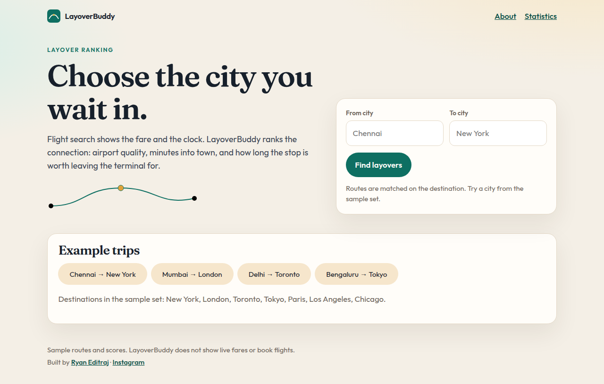
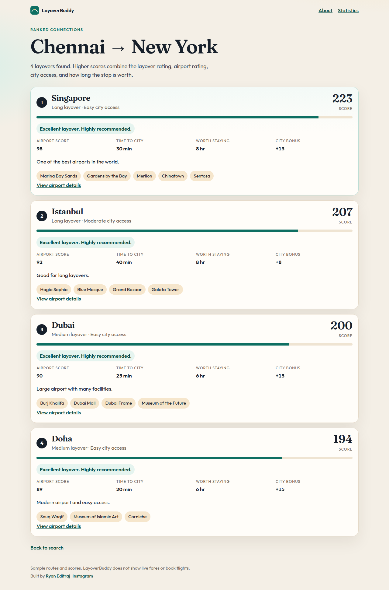
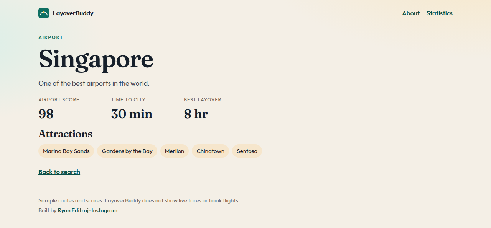
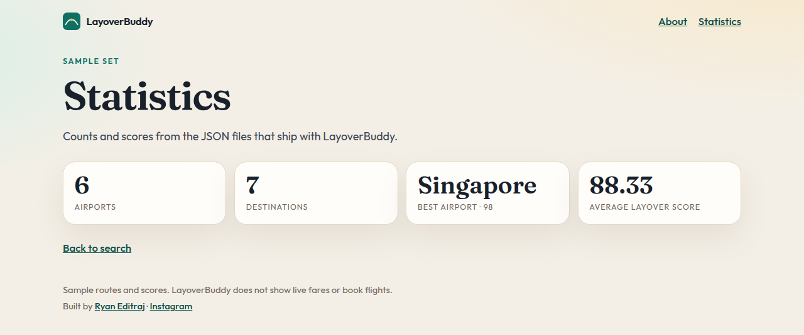

# LayoverBuddy

**The cheapest connection is not always the best one.** LayoverBuddy ranks the city you wait in — airport quality, minutes into town, and how long the stop is worth — so a layover can be part of the trip instead of a line on a fare screen.

[](https://github.com/ryaneditraj/LayoverBuddy/actions/workflows/ci.yml)
[](LICENSE)
[](https://www.python.org/)
[](https://flask.palletsprojects.com/)

LayoverBuddy is an open-source **layover comparison** app. Give it a trip such as Chennai to New York and it orders the connection cities in the sample set — Singapore, Istanbul, Dubai, Doha — with a score, a plain-language recommendation, airport notes, and things to do if you leave the terminal.

It does **not** search live fares, and it does not book flights. The routes and scores ship in JSON files you can read and edit.

## Demo



*Search from the home page, or start from an example trip.*



*Chennai → New York. Singapore leads, then Istanbul, Dubai, and Doha.*



*Airport page for Singapore, including the attractions stored for that city.*



*How many airports are ranked, and which one scores highest.*

## Features

- **Layover city ranking** for a destination, highest score first
- **Airport facts**: score, minutes to the city, recommended hours, and a short note
- **Plain-language recommendation** from the same score (excellent, very good, good, average, or not recommended)
- **Attractions** for each layover city, such as Marina Bay Sands or the Grand Bazaar
- **Statistics** for the sample set: airport count, best airport, average layover score
- **Example trips** so a first visit does not depend on guessing a city the dataset knows
- Phone-friendly layout, with no account required

## Tech stack

| Layer | Choice |
| --- | --- |
| Language | Python 3.11+ |
| Web | Flask 3.1.3, Jinja2 3.1.6, Werkzeug 3.1.9 |
| Interface | HTML and CSS (Fraunces and Outfit, SIL Open Font License) |
| Data | JSON files in the repository. No database |
| Tests | `unittest`, run in GitHub Actions |

## Quick start

```bash
git clone https://github.com/ryaneditraj/LayoverBuddy.git
cd LayoverBuddy
python -m venv .venv
source .venv/bin/activate
pip install -r requirements.txt
python app.py
```

Open http://127.0.0.1:5000.

On Windows, activate with `.venv\Scripts\activate`.

`python app.py` binds `0.0.0.0` on port `5000` so a container or a platform such as Railway can reach it. Override that with environment variables when you need to:

| Variable | Default | Purpose |
| --- | --- | --- |
| `HOST` | `0.0.0.0` | Interface the development server binds |
| `PORT` | `5000` | Port the development server binds |
| `FLASK_DEBUG` | off | Set to `1` only on your own machine |
| `SITE_URL` | request origin | Public origin for canonical, Open Graph, sitemap, and robots links |
| `TRUST_PROXY` | `0` | Set to `1` only behind a reverse proxy you control |

Copy `.env.example` if you want those names written down. The process reads the environment; it does not load a `.env` file by itself.

The Flask app object is named `app` in `app.py`. Importing the module does not start the server, so a WSGI server can load `app:app`.

## Usage

1. Enter a **from city** and a **to city**. The destination has to be one of New York, London, Toronto, Tokyo, Paris, Los Angeles, or Chicago. Matching ignores case and extra spaces, so `new york` works.
2. The origin is shown on the result. It does not pick a different route. Routes are stored by destination, so Chennai → New York and Mumbai → New York use the same layover list.
3. Read the ranking. The score is the sort key. The label is a band on top of that score.

### How a layover score is built

```
score = layover score + airport score + city-access bonus + duration bonus
```

| City access | Bonus |
| --- | --- |
| 30 minutes or less | +15 |
| 45 minutes or less | +8 |
| Longer | +2 |

| Recommended stop | Bonus |
| --- | --- |
| 8 hours or more | +15 |
| 6 hours or more | +10 |
| Shorter | +5 |

| Score | What you will read |
| --- | --- |
| 190 or more | Excellent layover. Highly recommended. |
| 170–189 | Very good option. |
| 150–169 | Good option. |
| 120–149 | Average option. |
| Below 120 | Not recommended. |

The hubs in the current sample set all land in the top band. The number is what separates them. Lower bands are there for cities you add later.

### Chennai → New York

| Rank | Layover | Score | Recommendation |
| --- | --- | --- | --- |
| 1 | Singapore | 223 | Excellent layover. Highly recommended. |
| 2 | Istanbul | 207 | Excellent layover. Highly recommended. |
| 3 | Dubai | 200 | Excellent layover. Highly recommended. |
| 4 | Doha | 194 | Excellent layover. Highly recommended. |

Singapore’s 223 is layover 95 + airport 98 + 15 for a 30-minute ride into the city + 15 because an 8-hour stop is worth taking.

## Project structure

```
.
├── app.py                 # Routes, pages, security headers
├── layovers.py            # Routes, scores, ranking math
├── airport_info.py        # Airport facts
├── attractions.py         # City attractions
├── recommendations.py     # Recommendation text
├── storage.py             # JSON loading anchored to the repo
├── routes.json            # Destination → layover cities
├── scores.json            # Base layover scores
├── airport_info.json      # Airport score, city time, hours, note
├── attractions.json       # Attractions by city
├── templates/             # HTML pages
├── static/                # CSS, favicon, fonts, social image
├── tests/test_app.py      # Ranking, escaping, and page checks
├── docs/screenshots/      # Pictures in the demo section above
├── .github/               # CI, Dependabot, issue and PR templates
├── robots.txt             # Crawler rules, served at /robots.txt
├── sitemap.xml            # Public URLs, served at /sitemap.xml
├── llms.txt               # Short brief for answer engines, served at /llms.txt
├── CONTRIBUTING.md
├── CODE_OF_CONDUCT.md
├── SECURITY.md
├── LICENSE
└── requirements.txt
```

## Roadmap

The sample set is the whole product today. Useful next steps, in no particular order:

- Live flight and route data, behind environment variables, with no keys in the repo
- A wider airport dataset, including transit time that is measured rather than hand-entered
- Visa and transit-visa notes for a nationality and a layover city
- Maps for the ride from the airport into town
- Saved trips, once there is a reason to have an account
- Side-by-side comparison when two fares use different hubs
- Search that understands airports and city aliases beyond the current destination list

## FAQ

### What is LayoverBuddy?

LayoverBuddy is a free open-source web app that ranks layover cities for a trip. It compares airport quality, time into the city, and how long the connection is worth, so you can judge the stop instead of looking only at the price.

### How do I compare layovers between two cities?

Run the app, enter an origin and a destination such as Chennai and New York, and submit the form. You get the sample connections for that destination, highest score first, with notes and attractions.

### How does LayoverBuddy score a layover airport?

It adds a layover score and an airport score, then a bonus for a short ride into the city and a bonus when the recommended stop is long enough to leave the airport. The tables in [Usage](#how-a-layover-score-is-built) are the exact rules.

### Which layover cities are included?

Singapore, Istanbul, Dubai, Doha, Amsterdam, and Seoul. Destinations with saved routes are New York, London, Toronto, Tokyo, Paris, Los Angeles, and Chicago.

### Does LayoverBuddy show live flight prices or book tickets?

No. It does not call an airline API. Everything you see comes from the JSON files in this repository.

### Why does my origin city not change the layover list?

Routes are stored by destination. The origin is there so the result reads as a trip, and it lives only in the URL.

### What is a good layover length in LayoverBuddy?

Each city has a recommended length in hours. Under 4 hours counts as short, under 8 as medium, and 8 or more as long. The score favors stops that are long enough to be worth leaving the terminal.

### Is LayoverBuddy free to use and open source?

Yes. It is MIT licensed. Clone it, run it, and send a pull request if you want to add a city.

### Who built LayoverBuddy?

[Ryan Editraj](https://github.com/ryaneditraj), an AI builder and tech creator. More of his work is on [Instagram](https://instagram.com/ryaneditraj).

## Contributing

Issues and pull requests are welcome, including new cities that keep the four JSON files in sync. Read [CONTRIBUTING.md](CONTRIBUTING.md) for setup and [CODE_OF_CONDUCT.md](CODE_OF_CONDUCT.md) for how to take part.

```bash
python -m unittest discover -s tests -v
```

## Security

Report a vulnerability in private through [GitHub security advisories](https://github.com/ryaneditraj/LayoverBuddy/security/advisories/new). See [SECURITY.md](SECURITY.md). Please do not file a public issue for a security bug.

## License

[MIT](LICENSE) © 2026 Ryan Editraj

The Fraunces and Outfit font files under `static/fonts/` stay under the [SIL Open Font License](static/fonts/Fraunces-OFL.txt).

## Author

**Ryan Editraj** — AI builder and tech creator

- GitHub: [github.com/ryaneditraj](https://github.com/ryaneditraj)
- Instagram: [instagram.com/ryaneditraj](https://instagram.com/ryaneditraj)
